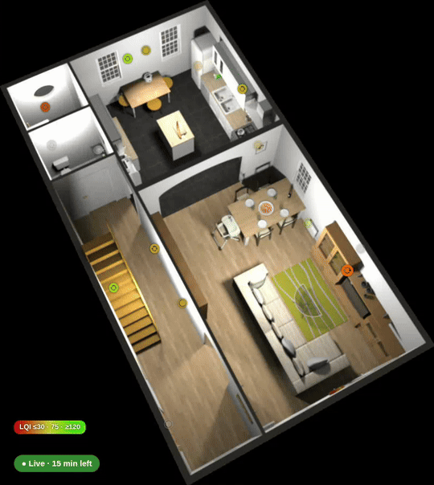

# Zigbee-Funkkarte für openHAB

Eine Raumplan-Seite für openHAB (MainUI), deren Marker die Live-Linkqualität (LQI) deiner Zigbee2MQTT-Geräte zeigen.
YAML musst du nicht von Hand schreiben: `generator.html` macht aus deiner Geräteliste die Seite und die Regel.



## Was sie zeigt

- Ein Marker pro Gerät auf deinem Raumplan-Bild. Farbe = LQI des letzten Hops: rot bei 30 oder weniger, gelb bei 75,
  grün bei 120 oder mehr, dazwischen fließend.
- Weiß = noch kein Wert. Grau = offline. Blass = älter als die aktuelle Live-Runde.
- Router und Endgeräte haben verschiedene Symbole. Antippen (oder Mausover) zeigt den Tooltip.
- Ein „Live“-Knopf auf der Seite schaltet den Live-Modus ein. Er schaltet sich nach 15 Minuten selbst aus
  (einstellbar). Außerhalb von Live wird nichts geschrieben, die Karte zeigt dann die letzten Werte.

## Voraussetzungen

- openHAB 5.1 oder neuer (nur mit 5.1.4 getestet, siehe „Getestet“)
- MQTT-Binding mit einem Broker-Thing, Add-on JavaScript Scripting
- Zigbee2MQTT, das an diesen Broker veröffentlicht
- Ein Raumplan-Bild in `conf/html/` (die Datei `conf/html/floorplan.png` wird als `/static/floorplan.png` ausgeliefert)

## Einrichten

1. **Kanäle.** Settings → Things → (dein Broker-Thing) → Channels → Add Channel → „Publish Trigger“. Zweimal.
   „Show advanced“ anklicken, dann erscheint der Separator.
   - Channel-ID `zbmap`, Topic `<base>/+`, Separator `#`
   - Channel-ID `zbmap_avail`, Topic `<base>/+/availability`, Separator `#`

   `<base>` ist dein Zigbee2MQTT-Basis-Topic, standardmäßig `zigbee2mqtt`.
2. **Generator.** `generator.html` im Browser öffnen (lokale Datei, funktioniert offline, nichts wird verschickt).
   Die Raumplan-Bilddatei wählen (nur ihre Größe wird gelesen), die URL des Bildes in openHAB eintragen, die
   Geräteliste einfügen und die UID des Broker-Things eintragen (zum Beispiel `mqtt:broker:mybroker`).
   Die Geräteliste ist das JSON von `zigbee2mqtt/bridge/devices`, zum Beispiel aus
   `mosquitto_sub -h <broker> -t zigbee2mqtt/bridge/devices -C 1`. Eine einfache Liste geht auch: ein Name pro Zeile,
   `Kitchen_Plug`, `Kitchen_Plug;router` oder `Hall_Coordinator;coordinator`.
3. **Regel** (Ergebnis „2. Regel“). Settings → Rules → + → Code-Tab → alles durch den kopierten Text ersetzen →
   Speichern → einmal „Run now“. Der erste Lauf legt die zwei Items `ZigbeeMap_Live` und `ZigbeeMap_Data` an. MainUI
   vergibt der Regel eventuell eine eigene UID; davon hängt nichts ab.
4. **Seite** (Ergebnis „3. Seite“). Settings → Pages → + → „Create floorplan“ → Code-Tab → alles durch den kopierten
   Text ersetzen → Speichern.
5. **Marker platzieren.** Geräte ohne Position stehen in einem Raster über dem ganzen Bild, nach Namen sortiert.
   Im Seiten-Editor in die Räume ziehen. Steht mindestens ein Gerät noch im Raster, zeigt die Seite einen Hinweis
   dazu; den Hinweis löschen, wenn du fertig bist, dann speichern.
6. **Ausprobieren.** Seite öffnen, „Live“ antippen. Die Marker werden farbig, sobald die Geräte melden.
7. **Optional: die zwei Items nicht speichern.** Settings → Persistence: `!ZigbeeMap_Live` und `!ZigbeeMap_Data` in
   die Konfiguration jedes Dienstes eintragen, der `*` speichert. Das Daten-Item ist ein JSON-Text, der sich während
   Live jede Sekunde ändert, das willst du nicht in einer Datenbank haben.

### Schnellstart oder zweites Broker-Thing

- **Schnellstart:** die zwei Kanäle am vorhandenen Broker-Thing anlegen und im Generator „zweites Broker-Thing“
  aus lassen. Dann löst jede Zigbee2MQTT-Nachricht ein Trigger-Ereignis aus, und damit jederzeit eine Zeile in
  `events.log`.
- **Empfohlen:** ein zweites Broker-Thing nur für die Karte. Settings → Things → Broker-Thing duplizieren (oder ein
  neues MQTT-Broker-Thing mit derselben Adresse anlegen), eigene Client-ID vergeben, **Discovery ausschalten**
  (sonst füllt sich die Inbox mit Duplikaten), die zwei Kanäle daran anlegen. Im Generator „zweites Broker-Thing“
  ankreuzen. Die Regel schaltet das Thing dann nur während Live ein und danach wieder aus. Sie schaltet nie ein
  Thing, das andere Things als Bridge benutzen (dein Haupt-Broker): sie schreibt stattdessen eine Warnung ins Log.

### Gerät später hinzufügen

Im Seiten-Editor einen Geräte-Marker derselben Art (Router oder Endgerät) kopieren und den neuen Gerätenamen bei
„name“ eintragen. Mehr ist nicht nötig.

## Was in `events.log` landet

- Während Live: das Daten-Item ändert sich höchstens einmal pro Sekunde, eine Zeile pro Schreibvorgang. Eine Zeile
  hat etwa 2 × 45 Bytes × Anzahl Geräte.
- Nur beim Schnellstart: zusätzlich jederzeit eine Zeile pro Zigbee2MQTT-Nachricht (siehe oben).
- Außerhalb von Live (mit zweitem Broker-Thing): nichts.

## Grenzen

- Steht Zigbee2MQTT auf dem Ausgabemodus `attribute`, haben die Nachrichten kein JSON mit `linkquality`. Dann beim
  ersten Kanal das Topic `<base>/+/linkquality` nehmen. Die Standardmodi `json` und `attribute_and_json` gehen
  unverändert.
- Gerätenamen mit `/` brauchen einen zusätzlichen Kanal mit passendem Topic.
- Retained-MQTT-Nachrichten kommen beim Live-Start sofort an und zählen als frische Werte.
- Die LQI gilt nur für den letzten Hop (Gerät zu seinem Parent-Router oder zum Koordinator), nicht für den ganzen
  Weg.

## Demo ohne Zigbee

`demo/` enthält eine Seite und eine Regel mit erfundenen Geräten (`Kitchen_Plug`, `Front_Door`, ...) auf dem
Raumplan-Bild der openHAB-Demo-Instanz. Die Regel speist simulierte Nachrichten durch denselben Parser und dasselbe
Datenformat, MQTT ist nicht nötig. Regel und Seite wie in Schritt 3 und 4 einspielen (Dateien
`demo/zigbee_map_demo_rule.yaml` und `demo/zigbee_map_demo_page.yaml`; Items `ZigbeeMapDemo_Live` und
`ZigbeeMapDemo_Data`, Regel-UID `zigbee_radio_map_demo`). Die Seite verlinkt das Raumplan-Bild der openHAB-Demo
(Repo `openhab/openhab-demo`, EPL-2.0) nur und enthält es nicht. Lädt das Bild von `demo.openhab.org` nicht, eine
Kopie nach `conf/html/` legen und `imageUrl` in der Seite ändern.

## Entfernen

Seite und Regel löschen, die zwei Items löschen, die zwei Kanäle löschen (und das zweite Broker-Thing, falls
angelegt), die Persistenz-Ausnahmen entfernen.

## Getestet

- Vom Autor: openHAB 5.1.4, Zigbee2MQTT mit 16 Geräten, der empfohlene Weg mit zweitem Broker-Thing, der Generator
  in einem Desktop-Browser (Kopieren, Bildgröße), Seite und Regel in einer echten MainUI, einschließlich
  `config.name` in einem Marker-Ausdruck.
- Automatische Tests außerhalb von openHAB: die Regel in einer Sandbox, die Seiten-Ausdrücke mit der
  Ausdrucks-Bibliothek, die auch MainUI benutzt, der Generator in Headless-Firefox, alles gegen die Quellen von
  openHAB 5.1.4.

**Noch nicht getestet:** der Schnellstart-Weg (Kanäle am Haupt-Broker-Thing), Demo-Regel und Demo-Seite in einer
echten MainUI, andere openHAB-Versionen als 5.1.4.

## Bauen und testen

`generator.html` und die Dateien in `demo/` werden gebaut; nicht von Hand ändern. Die Quellen liegen in `src/`.

```
cd test && npm install            # nur Test-Abhängigkeiten, zur Laufzeit wird nichts gebraucht
cd ..
node test/rule.test.js
node test/gen.test.js
node test/expr.test.js
node test/build.test.js
node build.js                     # baut generator.html und demo/*.yaml neu; ein zweiter Lauf ändert nichts
```

`test/probe.js` rendert eine erzeugte Seite als einfaches HTML-Probebild (Näherung der MainUI-Raumplan-Seite):
`node test/probe.js OUT.html PAGE.yaml RULE.yaml BACKGROUND_IMAGE [Sekunden]`, danach `OUT.html` fotografieren
(zum Beispiel mit Headless-Firefox).

## Lizenz

Copyright (c) 2026 mars-online

Eclipse Public License 2.0 (`EPL-2.0`), dieselbe Lizenz wie openHAB, siehe `LICENSE`.
