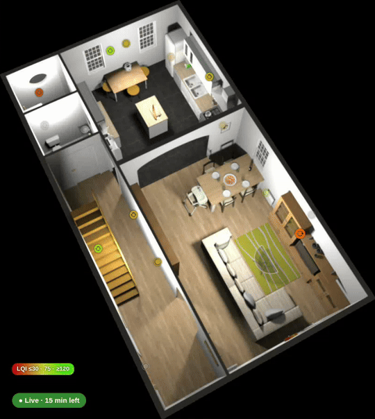

# Zigbee radio map for openHAB

A floor plan page for openHAB (MainUI) whose markers show the live link quality (LQI) of your Zigbee2MQTT devices.
You do not edit YAML by hand: `generator.html` takes your device list and produces the page and the rule.



## What it shows

- One marker per device on your floor plan image. Colour = LQI of the last hop: red at 30 or less, yellow at 75,
  green at 120 or more, smooth in between.
- White = no value yet. Grey = offline. Pale = older than the current live session.
- Routers and end devices have different icons. Tap a marker (or hover) for the tooltip.
- A "Live" button on the page switches live mode on. It switches itself off after 15 minutes (configurable).
  Outside live nothing is written, so the map shows the last values.

## Prerequisites

- openHAB 5.1 or newer (tested with 5.1.4 only, see "Tested")
- MQTT binding with a broker thing, JavaScript Scripting add-on
- Zigbee2MQTT publishing to that broker
- A floor plan image, placed in `conf/html/` (a file `conf/html/floorplan.png` is served as `/static/floorplan.png`)

## Install

1. **Channels.** Settings → Things → (your broker thing) → Channels → Add Channel → "Publish Trigger". Do this twice.
   Click "Show advanced" to see the separator.
   - Channel ID `zbmap`, topic `<base>/+`, separator `#`
   - Channel ID `zbmap_avail`, topic `<base>/+/availability`, separator `#`

   `<base>` is your Zigbee2MQTT base topic, `zigbee2mqtt` by default.
2. **Generator.** Open `generator.html` in a browser (a local file, works offline, nothing is sent anywhere).
   Choose the floor plan image file (only its size is read), enter its URL in openHAB, paste the device list and
   enter the broker thing UID (for example `mqtt:broker:mybroker`).
   The device list is the JSON of `zigbee2mqtt/bridge/devices`, for example from
   `mosquitto_sub -h <broker> -t zigbee2mqtt/bridge/devices -C 1`. A plain list also works: one name per line,
   `Kitchen_Plug`, `Kitchen_Plug;router` or `Hall_Coordinator;coordinator`.
3. **Rule** (result "2. Rule"). Settings → Rules → + → Code tab → replace everything with the copied text → Save →
   "Run now" once. The first run creates the two items `ZigbeeMap_Live` and `ZigbeeMap_Data`. MainUI may give the rule its
   own UID; nothing depends on it.
4. **Page** (result "3. Page"). Settings → Pages → + → "Create floorplan" → Code tab → replace everything with the
   copied text → Save.
5. **Place the markers.** Devices without a position are parked in a grid over the whole image, sorted by name.
   Open the page editor and drag them to their rooms. If at least one device is parked, the page shows a note about
   it; delete that note when you are done, then save.
6. **Try it.** Open the page, tap "Live". Markers turn from white to coloured as the devices report.
7. **Optional: no persistence for the two items.** Settings → Persistence: add `!ZigbeeMap_Live` and
   `!ZigbeeMap_Data` to the configuration of every service that stores `*`. The data item holds one JSON text that
   changes every second during live, which you do not want in a database.

### Quick start or second broker thing

- **Quick start:** put the two channels on your existing broker thing and leave "second broker thing" off in the
  generator. Every Zigbee2MQTT message then produces a trigger event, and with it one line in `events.log` at all
  times.
- **Recommended:** a second broker thing used only for the map. Settings → Things → duplicate your broker thing
  (or add a new MQTT broker thing with the same address), give it its own client ID, **turn discovery off** (otherwise
  the inbox fills with duplicates), and put the two channels on it. Tick "second broker thing" in the generator. The
  rule then enables that thing only during live and disables it afterwards. The rule never switches a thing that
  other things use as their bridge (your main broker): it logs a warning instead.

### Adding a device later

Open the page editor, copy a device marker of the same kind (router or end device) and type the new device name
into "name". Nothing else is needed.

## What is written to `events.log`

- During live: the data item changes at most once per second, one line per write. A line is about
  2 × 45 bytes × number of devices.
- Quick-start path only: additionally one line per Zigbee2MQTT message at all times (see above).
- Outside live (with a second broker thing): nothing.

## Limits

- If Zigbee2MQTT uses output mode `attribute`, the messages have no JSON with `linkquality`. Use the topic
  `<base>/+/linkquality` for the first channel instead. The default modes `json` and `attribute_and_json` work as is.
- Device names that contain `/` need an additional channel with a matching topic.
- Retained MQTT messages arrive as soon as live starts and count as fresh values.
- LQI is the quality of the last hop only (device to its parent router or the coordinator), not of the whole path.

## Demo without Zigbee

`demo/` holds a page and a rule with invented devices (`Kitchen_Plug`, `Front_Door`, ...) on the floor plan image of
the openHAB demo instance. The rule feeds simulated messages through the same parser and data format, no MQTT needed.
Install the rule and the page as in steps 3 and 4 (files `demo/zigbee_map_demo_rule.yaml` and
`demo/zigbee_map_demo_page.yaml`; items `ZigbeeMapDemo_Live` and `ZigbeeMapDemo_Data`, rule UID
`zigbee_radio_map_demo`). The page only links the floor plan image of the openHAB demo (repo `openhab/openhab-demo`,
EPL-2.0) and does not include it. If the image does not load from `demo.openhab.org`, put a copy into `conf/html/`
and change `imageUrl` in the page.

## Uninstall

Delete the page and the rule, delete the two items, delete the two channels (and the second broker thing, if you
made one), and remove the persistence exclusions.

## Tested

- By the author: openHAB 5.1.4, Zigbee2MQTT with 16 devices, the recommended path with a second broker thing, the
  generator in a desktop browser (copy, image size), the page and the rule in a real MainUI, including `config.name`
  inside a marker expression.
- Automated tests outside openHAB: the rule in a sandbox, the page expressions with the expression library MainUI
  uses, the generator in headless Firefox, all against the openHAB 5.1.4 sources.

**Not yet tested:** the quick-start path (channels on the main broker thing), the demo rule and page in a real MainUI,
openHAB versions other than 5.1.4.

## Build and test

`generator.html` and the files in `demo/` are built; do not edit them by hand. Sources are in `src/`.

```
cd test && npm install            # test-only dependencies, nothing is needed at runtime
cd ..
node test/rule.test.js
node test/gen.test.js
node test/expr.test.js
node test/build.test.js
node build.js                     # rebuilds generator.html and demo/*.yaml; a second run changes nothing
```

`test/probe.js` renders a generated page as a plain HTML probe image (approximation of the MainUI plan page):
`node test/probe.js OUT.html PAGE.yaml RULE.yaml BACKGROUND_IMAGE [seconds]`, then screenshot `OUT.html`
(for example with headless Firefox).

## Licence

Copyright (c) 2026 mars-online

Eclipse Public License 2.0 (`EPL-2.0`), the same licence as openHAB, see `LICENSE`.
